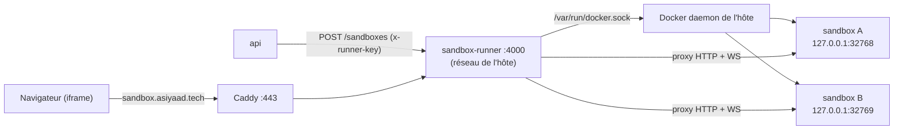

# sandbox-runner

Service Express qui transforme un dépôt Git en application utilisable dans le navigateur. Il clone le repo, construit son image Docker, lance un conteneur isolé, puis relaie le trafic HTTP et WebSocket du visiteur vers ce conteneur. Il détruit tout au bout de 30 minutes.

## Sommaire

- [Place dans l'architecture](#place-dans-larchitecture)
- [Notions de base](#notions-de-base)
- [Structure du code](#structure-du-code)
- [Création d'un sandbox, étape par étape](#création-dun-sandbox-étape-par-étape)
- [Le proxy : relayer HTTP et WebSocket](#le-proxy--relayer-http-et-websocket)
- [WebSocket en détail](#websocket-en-détail)
- [À l'intérieur d'un conteneur sandbox](#à-lintérieur-dun-conteneur-sandbox)
- [Le chemin complet d'une touche clavier](#le-chemin-complet-dune-touche-clavier)
- [Nettoyage et durée de vie](#nettoyage-et-durée-de-vie)
- [Contrat d'un projet lançable](#contrat-dun-projet-lançable)
- [Configuration](#configuration)
- [Sécurité et limites](#sécurité-et-limites)
- [Dépannage](#dépannage)

## Place dans l'architecture



Le runner a deux rôles :
1. **Orchestrateur** : il crée et détruit des conteneurs. Seule l'api peut le lui demander, grâce à la clé.
2. **Reverse proxy** : il relaie le trafic du visiteur vers le bon conteneur. Ces routes sont publiques.

## Notions de base

### Le socket Docker

Quand tu tapes `docker run`, la commande `docker` n'exécute rien elle-même. Elle envoie une requête HTTP au **Docker daemon** (`dockerd`) par un fichier spécial : le socket Unix `/var/run/docker.sock`. Le daemon est le programme qui crée réellement les conteneurs.

Le compose monte ce socket dans le runner :

```yaml
volumes:
  - /var/run/docker.sock:/var/run/docker.sock
```

Le runner utilise **dockerode**, une bibliothèque Node.js qui envoie ces mêmes requêtes HTTP au socket. `docker.buildImage(...)` envoie `POST /build`, `docker.createContainer(...)` envoie `POST /containers/create`, etc.

Conséquence importante : les conteneurs des sandboxes ne sont **pas** à l'intérieur du runner. Ils sont créés par le daemon de l'hôte, à côté des autres conteneurs (`docker ps` sur le VPS les montre). On appelle ce montage « Docker-out-of-Docker », par opposition à « Docker-in-Docker ».

### Pourquoi `network_mode: host`

Chaque sandbox publie son port 3000 sur `127.0.0.1:<port aléatoire>` **de l'hôte**. Pour l'atteindre, le runner doit voir le `127.0.0.1` de l'hôte, et pas le sien. Avec `network_mode: host`, le runner partage la pile réseau de la machine : son `127.0.0.1` est celui de l'hôte, et il écoute directement sur le port 4000 de la machine.

## Structure du code

```
apps/sandbox-runner/src/
├── main.ts     # démarre Express, branche les upgrades WebSocket, arrêt propre
├── routes.ts   # routes, authentification, Map des sandboxes, nettoyage
├── docker.ts   # clone, build, run, remove (dockerode + git)
└── proxy.ts    # proxy HTTP/WS dynamique (http-proxy-middleware)
```

L'état est une `Map` en mémoire :

```ts
Map<sandboxId, { containerId, port, contextPath, createAt }>
```

Elle n'est pas persistée. Si le runner redémarre, il perd la trace des sandboxes en cours (voir [Nettoyage](#nettoyage-et-durée-de-vie)).

## Création d'un sandbox, étape par étape

Requête reçue de l'api :

```http
POST /sandboxes HTTP/1.1
Host: host.docker.internal:4000
Content-Type: application/json
x-runner-key: 5c83...

{"repoUrl":"https://github.com/Xasiyy/Cub3D.git"}
```

### Étape 1 : authentification (`requireApiKey`)

```ts
if (!expected || provided.length !== expected.length
    || !timingSafeEqual(Buffer.from(provided), Buffer.from(expected)))
  -> 401
```

- `timingSafeEqual` compare les deux clés **en temps constant**. Une comparaison classique (`===`) s'arrête au premier caractère différent, et un attaquant pourrait deviner la clé caractère par caractère en mesurant le temps de réponse.
- La vérification de longueur vient en premier, parce que `timingSafeEqual` lève une exception si les deux buffers n'ont pas la même taille.
- `!expected` protège contre une variable non définie : sans ce test, une clé vide côté serveur accepterait une clé vide côté client.

### Étape 2 : contrôle de capacité

```ts
if (sandbox.size + inFlight >= MAX_SANDBOXES) -> 503
```

`sandbox.size` compte les sandboxes déjà lancés, et `inFlight` ceux en cours de construction. Sans `inFlight`, dix requêtes simultanées passeraient toutes le test avant que la première n'ait fini son build. `inFlight` est incrémenté avant le travail et décrémenté dans un `finally`, donc même en cas d'erreur.

### Étape 3 : identifiant

```ts
const sandboxId = randomUUID();          // ex. 3f2b9c1e-...
const tag = `sandbox-${sandboxId}`;      // nom de l'image Docker
```

Un UUID v4 est impossible à deviner. C'est ce qui empêche un visiteur d'accéder au sandbox d'un autre visiteur.

### Étape 4 : clone du dépôt (`cloneRepo`)

```ts
const dir = await mkdtemp(path.join(tmpdir(), 'sandbox-'));   // /tmp/sandbox-aB3xYz
await execFileAsync('git', ['clone', '--depth', '1', repoUrl, dir]);
```

- `mkdtemp` crée un dossier temporaire au nom unique, dans le `/tmp` du conteneur runner.
- `--depth 1` ne télécharge que le dernier commit, sans l'historique. C'est beaucoup plus rapide.
- `execFile`, et non `exec` : les arguments sont passés tels quels à `git`, sans shell. Une URL contenant `; rm -rf /` ne serait jamais interprétée comme une commande.
- Pas d'identifiants : le repo doit être **public**. Un repo privé fait échouer le clone avec `could not read Username`.
- `git` est disponible parce que le Dockerfile du runner installe `apk add git`.

### Étape 5 : construction de l'image (`buildImage`)

```ts
const stream = await docker.buildImage(
  { context: contextPath, src: fs.readdirSync(contextPath) },
  { t: tag },
);
```

1. dockerode crée une archive **tar** du dossier cloné (le « contexte de build »).
2. Il l'envoie au daemon par `POST /build?t=sandbox-<id>`.
3. Le daemon exécute le `Dockerfile` du repo, étape par étape.
4. Le daemon renvoie un **flux** de messages JSON (`{"stream":"Step 1/8..."}`, `{"error":"..."}`).
5. `docker.modem.followProgress` lit ce flux jusqu'au bout. Si un message contient `error`, la promesse est rejetée.

Point important : un build Docker qui échoue ne renvoie pas une erreur HTTP. L'erreur arrive **dans le flux**. C'est pour ça que le code cherche `events.find((e) => e.error)`.

Le daemon garde les couches en cache. Le deuxième lancement du même projet est donc beaucoup plus rapide, puisque `apt-get install` n'est pas refait.

### Étape 6 : lancement du conteneur (`runContainer`)

```ts
docker.createContainer({
  Image: tag,
  ExposedPorts: { '3000/tcp': {} },
  HostConfig: {
    PortBindings: { '3000/tcp': [{ HostIp: '127.0.0.1', HostPort: '0' }] },
    Memory: 256 * 1024 * 1024,
    NanoCpus: 1_000_000_000,
  },
});
```

| Option | Effet |
|---|---|
| `ExposedPorts 3000/tcp` | Le conteneur écoute sur le port 3000 |
| `HostIp: '127.0.0.1'` | Le port n'est publié que sur l'interface locale de l'hôte, il est invisible depuis Internet |
| `HostPort: '0'` | Docker choisit un port libre (ex. `32768`). Plusieurs sandboxes peuvent donc tourner en même temps sans conflit |
| `Memory` | 256 Mo maximum. Au-delà, le noyau tue le processus (OOM kill) |
| `NanoCpus` | 1 CPU maximum |

Après `container.start()`, le runner appelle `container.inspect()` pour lire le port réellement choisi par Docker dans `NetworkSettings.Ports['3000/tcp'][0].HostPort`.

### Étape 7 : enregistrement et réponse

```ts
sandbox.set(sandboxId, { containerId, port, contextPath, createAt: Date.now() });
res.json({ sandboxId, port });
```

### En cas d'échec

Le bloc `catch` supprime le dossier cloné et l'image (si elle a été créée), puis répond `500` avec le message d'erreur (par exemple le message de `git` ou du build). L'api transforme cette erreur en `502`.

## Le proxy : relayer HTTP et WebSocket

Fichier : `proxy.ts`. Toute requête dont l'URL commence par `/sandboxes/<id>` est relayée vers le conteneur correspondant.

```ts
router.use('/sandboxes/:id', checkSandboxExists(sandbox), sandboxProxy);
```

1. `checkSandboxExists` répond `404` si l'id n'est pas dans la Map.
2. `sandboxProxy` est un `createProxyMiddleware` de http-proxy-middleware, avec trois réglages :

| Réglage | Rôle |
|---|---|
| `router` | Calcule la cible **à chaque requête** : il lit l'id, cherche le port dans la Map et renvoie `http://127.0.0.1:<port>` |
| `pathRewrite` | Retire le préfixe `/sandboxes/<id>`. Le conteneur reçoit `/vnc.html`, pas `/sandboxes/<id>/vnc.html` |
| `ws: true` | Active le relais des WebSockets |
| `on.error` | Si le conteneur ne répond pas : `502 Sandbox unreachable` (HTTP) ou fermeture de la connexion (WS) |

Exemple :

```
Navigateur : GET /sandboxes/3f2b.../vnc.html?autoconnect=true
                    │  router      -> http://127.0.0.1:32768
                    │  pathRewrite -> /vnc.html?autoconnect=true
                    v
Conteneur  : GET /vnc.html?autoconnect=true
```

Le DELETE est déclaré **avant** le proxy dans `routes.ts`. Sinon, `DELETE /sandboxes/<id>` serait relayé au conteneur au lieu de supprimer le sandbox.

## WebSocket en détail

### Le problème que résout WebSocket

HTTP fonctionne en question/réponse : le client demande, le serveur répond, et c'est fini. Pour un écran distant ou un terminal, il faut un canal **ouvert en permanence et bidirectionnel**. Le serveur doit pouvoir envoyer une nouvelle image sans qu'on la lui demande, et le client doit pouvoir envoyer une touche à n'importe quel moment.

### Le handshake

Une connexion WebSocket commence par une requête HTTP normale, qui demande à changer de protocole :

```http
GET /sandboxes/3f2b.../websockify HTTP/1.1
Host: sandbox.asiyaad.tech
Upgrade: websocket
Connection: Upgrade
Sec-WebSocket-Key: dGhlIHNhbXBsZSBub25jZQ==
Sec-WebSocket-Version: 13
```

Le serveur accepte :

```http
HTTP/1.1 101 Switching Protocols
Upgrade: websocket
Connection: Upgrade
Sec-WebSocket-Accept: s3pPLMBiTxaQ9kYGzzhZRbK+xOo=
```

Après le `101`, la connexion TCP reste ouverte et ne transporte plus du HTTP, mais des **trames** WebSocket, dans les deux sens, jusqu'à ce que l'un des deux la ferme.

### Pourquoi `server.on('upgrade', ...)` dans `main.ts`

Express ne voit que les requêtes HTTP classiques. Une demande d'upgrade est signalée par Node.js sur un événement à part, `upgrade`, du serveur HTTP, et elle ne passe jamais par les routes Express. Il faut donc la brancher à la main :

```ts
server.on('upgrade', sandboxProxy.upgrade);
```

Dans ce cas, `req.params.id` n'existe pas, puisque le routeur Express n'a pas tourné. C'est pour ça que `getSandboxProxy` lit l'id directement dans `req.url` avec l'expression régulière `^/sandboxes/([^/]+)`.

### Chaque proxy doit laisser passer l'upgrade

Pour qu'un WebSocket fonctionne, **chaque intermédiaire** doit relayer le handshake et garder la connexion ouverte :

```
Navigateur --wss--> Caddy --ws--> runner --ws--> websockify (conteneur)
```

- Caddy le fait automatiquement avec `reverse_proxy`.
- Le runner le fait grâce à `ws: true` et au branchement de `upgrade`.

Si un seul maillon ne le fait pas, la page s'affiche mais la connexion n'aboutit jamais.

## À l'intérieur d'un conteneur sandbox

Chaque projet fournit son propre `Dockerfile`. Il en existe deux familles.

### Graphique : Xvfb, x11vnc, websockify, noVNC

Utilisé par Cub3D et push_swap. Exemple de `start.sh` (Cub3D) :

```bash
Xvfb :99 -screen 0 1024x768x24 &
sleep 1
DISPLAY=:99 ./cub3D maps/valid_subject.cub &
x11vnc -display :99 -forever -shared -nopw -rfbport 5900 -quiet &
exec websockify --web=/usr/share/novnc/ 3000 localhost:5900
```

| Programme | Rôle |
|---|---|
| **Xvfb** (X virtual framebuffer) | Serveur graphique X11 sans écran physique. Il dessine dans la mémoire. `:99` est le numéro de l'écran virtuel |
| **le programme** (`./cub3D`) | Application graphique normale (MiniLibX utilise X11). `DISPLAY=:99` lui dit de s'afficher sur l'écran virtuel |
| **x11vnc** | Lit l'image de l'écran `:99` et la sert en protocole **VNC** (RFB) sur le port TCP 5900. Il reçoit aussi le clavier et la souris et les injecte dans X11 |
| **websockify** | Un navigateur ne peut pas ouvrir une connexion TCP brute vers le port 5900. websockify accepte des WebSockets sur le port 3000 et les traduit en TCP vers le port 5900. Grâce à `--web`, il sert aussi les fichiers du client noVNC (`vnc.html`, JS) |
| **noVNC** (dans le navigateur) | Client VNC écrit en JavaScript. Il décode les images reçues et les dessine dans un `<canvas>` |

`exec` remplace le shell par websockify, qui devient le processus principal du conteneur. Si websockify s'arrête, le conteneur s'arrête.

### Terminal : ttyd

Utilisé par minishell et transcendence. Exemple (minishell) :

```dockerfile
CMD ["ttyd", "-p", "3000", "-W", "-t", "titleFixed=minishell", "-t", "disableLeaveAlert=true", "./minishell"]
```

| Élément | Rôle |
|---|---|
| **ttyd** | Lance le programme dans un pseudo-terminal (pty) et le partage sur le web |
| `-p 3000` | Port d'écoute |
| `-W` | Mode écriture. Sans cette option, le terminal est en lecture seule |
| `-t ...` | Options du client xterm.js (titre, pas d'alerte à la fermeture) |
| **xterm.js** (dans le navigateur) | Émulateur de terminal qui affiche la sortie et envoie les frappes par WebSocket |

Le Dockerfile de minishell est en **multi-stage** : une première image compile avec `build-essential`, puis l'image finale ne garde que le binaire, `libreadline` et ttyd. L'image est plus légère et se lance plus vite.

## Le chemin complet d'une touche clavier

Le visiteur appuie sur `W` dans Cub3D :

```
1. noVNC (navigateur) encode l'événement clavier en message RFB
2. trame WebSocket chiffrée (TLS)       -> 72.62.43.66:443
3. Caddy déchiffre                      -> 127.0.0.1:4000
4. sandbox-runner (proxy WS)            -> 127.0.0.1:32768
5. docker-proxy / iptables (hôte)       -> conteneur:3000
6. websockify : WebSocket -> TCP        -> localhost:5900
7. x11vnc injecte la touche dans X11    -> écran :99
8. cub3D reçoit l'événement et redessine la scène
9. x11vnc détecte les pixels modifiés et renvoie l'image en sens inverse, jusqu'au <canvas>
```

## Nettoyage et durée de vie

| Mécanisme | Déclencheur | Action |
|---|---|---|
| TTL | toutes les 5 min, sandboxes de plus de 30 min | `deleteSandbox` |
| `DELETE /sandboxes/:id` | appel avec la clé | `deleteSandbox` |
| Arrêt du runner | `SIGTERM` / `SIGINT` | `deleteSandbox` pour chaque sandbox, puis `server.close()` |
| Échec de création | erreur pendant clone, build ou run | suppression du dossier et de l'image |

Avec un TTL de 30 min et une vérification toutes les 5 min, un sandbox vit entre 30 et 35 minutes.

`deleteSandbox(id)` :
1. ignore l'appel si une suppression de ce sandbox est déjà en cours (`pendingDeletions`), pour éviter une double suppression ;
2. supprime le conteneur (`remove({ force: true })`, qui l'arrête s'il tourne) ;
3. supprime l'image `sandbox-<id>` ;
4. supprime le dossier cloné ;
5. retire l'entrée de la Map.

Chaque étape est dans un `try/catch` séparé : si le conteneur a déjà disparu, la suite du nettoyage a quand même lieu.

`stop_grace_period: 30s` dans le compose laisse au runner 30 secondes pour faire ce nettoyage avant que Docker ne le tue.

**Limite connue** : si le runner plante (au lieu de s'arrêter proprement), la Map est perdue, et les conteneurs `sandbox-*` restent orphelins. Pour les retrouver et les supprimer :

```bash
docker ps -a --filter "ancestor=sandbox-" --format '{{.ID}} {{.Image}}'
docker ps -a --format '{{.ID}} {{.Image}}' | grep ' sandbox-' | awk '{print $1}' | xargs -r docker rm -f
docker images --format '{{.Repository}}' | grep '^sandbox-' | xargs -r docker rmi -f
docker builder prune -f   # vide le cache de build si le disque se remplit
```

## Contrat d'un projet lançable

| Exigence | Raison |
|---|---|
| Repo **public** | Le clone se fait sans identifiants |
| `Dockerfile` à la racine | C'est le contexte de build envoyé au daemon |
| Écoute sur le **port 3000** | C'est le port relayé par le runner |
| Mode graphique : noVNC sur `/vnc.html` et WebSocket sur `/websockify` | URL construite par le frontend |
| Mode terminal : ttyd à la racine | URL construite par le frontend |
| Moins de 256 Mo de RAM | Limite du conteneur |
| Build en moins de 200 s | Timeout de l'api |

## Configuration

| Variable | Défaut | Rôle |
|---|---|---|
| `RUNNER_API_KEY` | obligatoire | Clé partagée avec l'api |
| `PORT` | `4000` | Port d'écoute (sur l'hôte, à cause du mode `host`) |
| `MAX_SANDBOXES` | `4` | Sandboxes simultanés, en comptant ceux en construction |

| Constante (`routes.ts`) | Valeur |
|---|---|
| `SANDBOX_TTL_MS` | 30 min |
| `CLEANUP_INTERVAL_MS` | 5 min |

## Sécurité et limites

| Mesure | Détail |
|---|---|
| Création et suppression protégées | Clé `x-runner-key`, comparée en temps constant |
| Le repo à lancer est choisi par l'api | Le visiteur ne fournit qu'un id de projet |
| Pas d'injection de commande | `execFile`, sans shell |
| Ports des sandboxes non exposés | `127.0.0.1` uniquement |
| Port 4000 non exposé | Pare-feu UFW : ouvert seulement aux réseaux Docker. Accès public uniquement via Caddy |
| Ressources plafonnées | 256 Mo, 1 CPU, 4 sandboxes |
| Identifiants imprévisibles | UUID v4 |

Limites connues, à garder en tête :

- **Accès au socket Docker** : le runner contrôle entièrement le daemon de l'hôte, ce qui équivaut à un accès root. Il ne faut lancer que des repos de confiance, car le `Dockerfile` d'un projet est exécuté par le daemon de l'hôte.
- **Réseau des sandboxes** : les conteneurs ont accès à Internet (réseau `bridge` par défaut).
- **Pas de limite de processus** : un programme peut créer beaucoup de processus (`PidsLimit` non défini).
- **Routes du proxy publiques** : toute personne qui connaît un `sandboxId` valide peut ouvrir ce sandbox pendant sa durée de vie.

## Dépannage

```bash
docker compose -f apps/docker-compose.prod.yml logs -f sandbox-runner
docker ps --format '{{.Names}} {{.Image}} {{.Ports}}' | grep sandbox-
curl -s http://127.0.0.1:4000/health
```

| Message ou symptôme | Cause |
|---|---|
| `401 Unauthorized` | Clé absente ou différente de celle de l'api |
| `503 Too many sandboxes running` | `MAX_SANDBOXES` atteint |
| `could not read Username for 'https://github.com'` | Repo privé ou URL erronée |
| Erreur du `Dockerfile` dans la réponse | Le build du projet échoue. Le reproduire avec `docker build .` dans le repo |
| `No host port assigned to container` | Le conteneur s'est arrêté immédiatement (vérifier son `CMD`) |
| `Proxy error for sandbox ...` dans les logs | Le conteneur n'écoute pas (encore) sur 3000, ou il a été tué (mémoire) |
| `404 Sandbox not found` | Sandbox expiré (TTL) ou runner redémarré |
