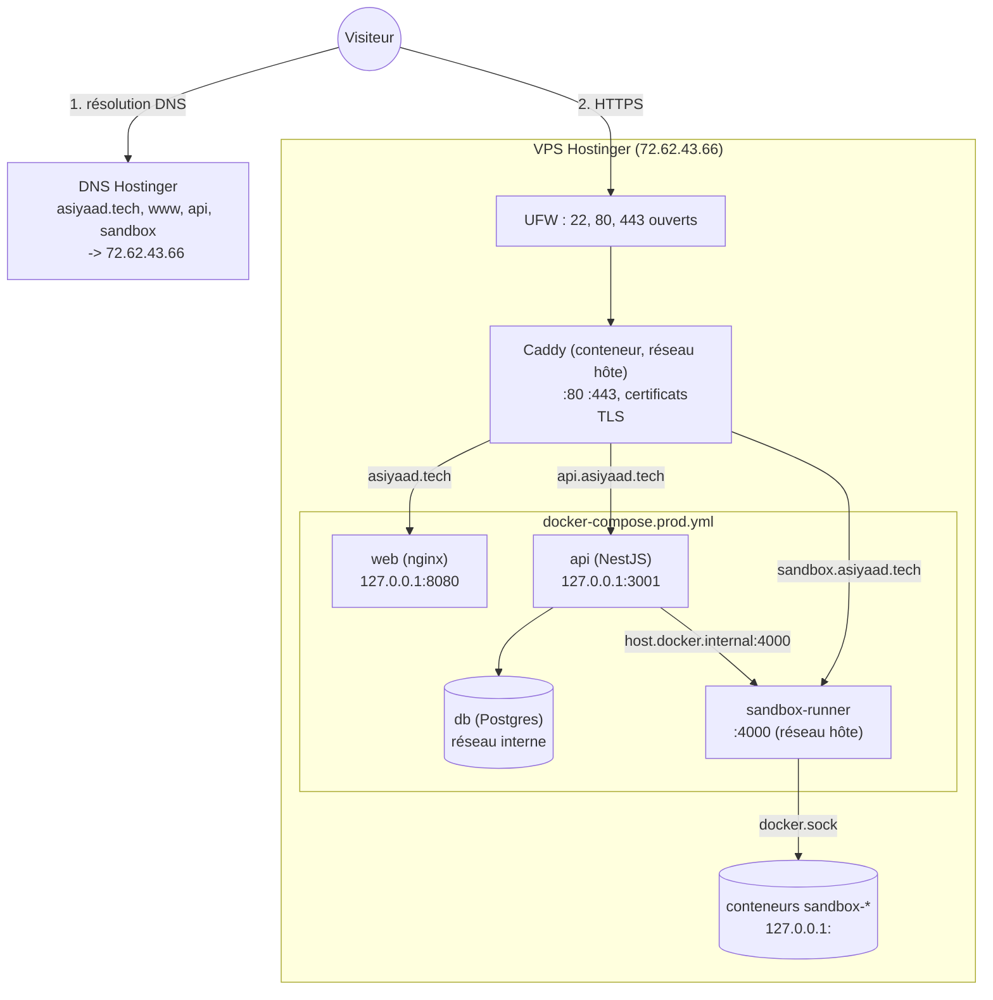

# Déploiement sur le VPS

Ce document explique comment le portfolio est hébergé en production : la machine, le DNS, le pare-feu, Caddy, Docker, et le chemin complet d'une requête depuis le navigateur jusqu'aux conteneurs.

## Sommaire

- [Vue d'ensemble](#vue-densemble)
- [Le serveur](#le-serveur)
- [DNS](#dns)
- [Chemin complet d'une requête](#chemin-complet-dune-requête)
- [Caddy](#caddy)
- [Docker et Docker Compose](#docker-et-docker-compose)
- [Pare-feu (UFW)](#pare-feu-ufw)
- [Carte des ports](#carte-des-ports)
- [Installation depuis zéro](#installation-depuis-zéro)
- [Mettre à jour le site](#mettre-à-jour-le-site)
- [Sauvegardes](#sauvegardes)
- [Dépannage](#dépannage)

## Vue d'ensemble



Règle générale : **seul Caddy est exposé à Internet**. Tous les autres services écoutent sur `127.0.0.1` ou sur un réseau Docker interne.

## Le serveur

| Élément | Valeur |
|---|---|
| Hébergeur | Hostinger (offre VPS) |
| Nom d'hôte | `srv2016061` |
| IP publique | `72.62.43.66` |
| Système | [A COMPLETER : ex. Ubuntu 24.04 LTS] |
| Utilisateur | `xasiy` (non root, membre des groupes `sudo` et `docker`) |
| Code du projet | `/srv/portfolio` |
| Configuration Caddy | [A COMPLETER : dossier du compose Caddy] |

La connexion se fait en SSH :

```bash
ssh xasiy@72.62.43.66
```

## DNS

Le domaine `asiyaad.tech` est géré dans le panneau Hostinger (hPanel, section DNS / Nameservers). Un enregistrement **A** associe un nom à une adresse IPv4 :

| Type | Nom | Valeur | Sert à |
|---|---|---|---|
| A | `@` | `72.62.43.66` | `asiyaad.tech` |
| A | `www` | `72.62.43.66` | redirection vers `asiyaad.tech` |
| A | `api` | `72.62.43.66` | api |
| A | `sandbox` | `72.62.43.66` | sandbox-runner |

Les quatre noms pointent vers la **même IP**. C'est Caddy qui fait la différence entre eux, grâce au nom demandé (voir [SNI et en-tête Host](#comment-caddy-sait-quel-site-servir)).

Vérification :

```bash
dig +short sandbox.asiyaad.tech     # doit afficher 72.62.43.66
```

Un nouvel enregistrement peut mettre de quelques minutes à quelques heures à se propager.

## Chemin complet d'une requête

Exemple : le navigateur charge `https://api.asiyaad.tech/projects`.

```
1. DNS        api.asiyaad.tech -> 72.62.43.66
2. TCP        connexion vers 72.62.43.66:443
3. UFW        port 443 autorisé -> la connexion entre
4. TLS        le navigateur annonce "api.asiyaad.tech" (SNI)
              Caddy présente le certificat Let's Encrypt de ce nom
              -> canal chiffré établi
5. HTTP       GET /projects, Host: api.asiyaad.tech
6. Caddy      bloc "api.asiyaad.tech" -> reverse_proxy 127.0.0.1:3001
              ajoute X-Forwarded-For (IP du visiteur) et X-Forwarded-Proto
7. Docker     127.0.0.1:3001 (hôte) -> conteneur api:3001 (port publié)
8. api        lit la base sur db:5432 (réseau Docker interne)
9. retour     même chemin en sens inverse, rechiffré par Caddy
```

Le chiffrement s'arrête à Caddy : on parle de **terminaison TLS**. Entre Caddy et les services, le trafic circule en HTTP simple, mais il ne quitte jamais la machine.

## Caddy

### Pourquoi Caddy

Caddy est un serveur web et un reverse proxy qui gère **HTTPS automatiquement** :
- il obtient les certificats auprès de Let's Encrypt (protocole ACME) dès qu'un domaine apparaît dans sa configuration ;
- il les renouvelle avant leur expiration (les certificats durent 90 jours) ;
- il redirige automatiquement HTTP vers HTTPS ;
- il relaie les WebSockets sans configuration supplémentaire.

Avec nginx, il aurait fallu installer certbot, écrire les blocs SSL et ajouter à la main les en-têtes `Upgrade` et `Connection` pour les WebSockets.

### Comment Caddy est lancé

Caddy tourne dans un conteneur à part, géré par son propre compose (projet `caddy`, conteneur `caddy-caddy-1`, image `caddy:2-alpine`). Il n'est pas dans `docker-compose.prod.yml`, parce qu'il est partagé par tout le serveur et peut servir d'autres sites.

[A COMPLETER : chemin du fichier, ex. /srv/caddy/docker-compose.yml]

```yaml
services:
  caddy:
    image: caddy:2-alpine
    network_mode: host
    volumes:
      - ./Caddyfile:/etc/caddy/Caddyfile
      - caddy_data:/data
      - caddy_config:/config
    restart: unless-stopped

volumes:
  caddy_data:
  caddy_config:
```

| Élément | Pourquoi |
|---|---|
| `network_mode: host` | Caddy doit écouter sur les ports 80 et 443 de la machine, et joindre `127.0.0.1:8080/3001/4000` de l'hôte |
| `./Caddyfile:/etc/caddy/Caddyfile` | La configuration est éditée sur l'hôte et lue par le conteneur |
| `caddy_data:/data` | **Stocke les certificats.** Sans ce volume, Caddy redemanderait tous ses certificats à chaque redémarrage et atteindrait vite les limites de Let's Encrypt |

### Le Caddyfile

```caddy
asiyaad.tech {
    reverse_proxy 127.0.0.1:8080
}

www.asiyaad.tech {
    redir https://asiyaad.tech{uri} permanent
}

api.asiyaad.tech {
    reverse_proxy 127.0.0.1:3001
}

sandbox.asiyaad.tech {
    reverse_proxy 127.0.0.1:4000
}
```

| Bloc | Rôle |
|---|---|
| `asiyaad.tech` | Site principal, servi par nginx (conteneur `web`) |
| `www.asiyaad.tech` | Redirection permanente (`301`) vers le domaine sans `www`. `{uri}` conserve le chemin demandé |
| `api.asiyaad.tech` | api NestJS |
| `sandbox.asiyaad.tech` | sandbox-runner : pages noVNC et ttyd, WebSockets |

### Comment Caddy sait quel site servir

Les quatre domaines arrivent sur la même IP et le même port 443. Caddy les distingue à deux moments :

1. **Pendant la négociation TLS**, grâce au **SNI** (Server Name Indication) : le navigateur annonce en clair le nom du site voulu, et Caddy choisit le certificat correspondant.
2. **Une fois la connexion chiffrée**, grâce à l'en-tête HTTP `Host`, qui désigne le bloc du Caddyfile à utiliser.

Si un nom n'a pas de bloc, Caddy n'a aucun certificat à présenter et coupe la négociation. Le navigateur affiche alors `SSL_ERROR_INTERNAL_ERROR_ALERT`, et curl `tlsv1 alert internal error`. C'est exactement ce qui se passait quand le bloc `sandbox.asiyaad.tech` manquait.

### Obtention d'un certificat

Quand un nouveau domaine apparaît dans le Caddyfile :

1. Caddy demande un certificat à Let's Encrypt.
2. Let's Encrypt vérifie que Caddy contrôle bien le domaine (challenge HTTP-01 sur le port 80, ou TLS-ALPN-01 sur le port 443). C'est pour ça que le DNS doit déjà pointer vers le VPS, et que les ports 80 et 443 doivent être ouverts.
3. Le certificat est enregistré dans `/data`.

### Recharger la configuration

Après chaque modification du Caddyfile :

```bash
docker exec caddy-caddy-1 caddy reload --config /etc/caddy/Caddyfile
```

`reload` applique la nouvelle configuration sans couper les connexions en cours. Le chemin commence par `/` : c'est le chemin **dans le conteneur**.

Si la modification n'est pas prise en compte, c'est souvent que l'éditeur a remplacé le fichier au lieu de le modifier, et le conteneur voit encore l'ancien. Pour le vérifier, puis redémarrer :

```bash
docker exec caddy-caddy-1 cat /etc/caddy/Caddyfile
docker restart caddy-caddy-1
```

Logs, et état des certificats :

```bash
docker logs caddy-caddy-1 --tail 50
docker logs caddy-caddy-1 2>&1 | grep -i "certificate obtained"
```

## Docker et Docker Compose

L'application est décrite dans `apps/docker-compose.prod.yml`. Docker Compose lit aussi `apps/.env` pour remplacer les `${VARIABLE}`.

| Service | Image | Réseau | Exposition |
|---|---|---|---|
| `db` | `postgres:16-alpine` | réseau du compose | non publié, joignable seulement par `api` |
| `api` | build `apps/api/Dockerfile` | réseau du compose | `127.0.0.1:3001` |
| `web` | build `apps/web/Dockerfile` | réseau du compose | `127.0.0.1:8080` |
| `sandbox-runner` | build `apps/sandbox-runner/Dockerfile` | **hôte** | `:4000` sur la machine (filtré par UFW) |

### Les réseaux Docker

- **Réseau du compose** : Compose crée un réseau privé (`apps_default`). Les conteneurs s'y joignent par leur nom de service grâce au DNS interne de Docker. C'est pour ça que `DATABASE_URL` utilise `@db:5432`.
- **Réseau hôte** : le runner n'a pas de réseau à lui. Il partage celui de la machine, pour joindre les ports `127.0.0.1:<aléatoire>` des sandboxes.
- **Du réseau du compose vers l'hôte** : l'api joint le runner par `host.docker.internal`, déclaré avec `extra_hosts: host.docker.internal:host-gateway`. Docker le traduit en IP de la passerelle des conteneurs (`172.17.0.1`).

### Pourquoi `127.0.0.1:` devant les ports

```yaml
ports:
  - "127.0.0.1:3001:3001"
```

Sans le préfixe `127.0.0.1`, Docker publierait le port sur **toutes les interfaces**, donc sur l'IP publique. Et Docker écrit ses propres règles iptables, qui **passent avant UFW** : le port serait accessible depuis Internet même si UFW le bloque. Le préfixe limite la publication à l'interface locale, la seule que Caddy utilise.

### Les secrets

`apps/.env` existe seulement sur le serveur. Il est exclu par `.gitignore` et `.dockerignore`, et il faut le créer à la main lors de l'installation :

```
DB_PASSWORD=...
RUNNER_API_KEY=...           # openssl rand -hex 32
MAIL_USER=...@gmail.com
MAIL_PASS=...                # mot de passe d'application Google
MAIL_TO=...
```

```bash
chmod 600 /srv/portfolio/apps/.env
```

## Pare-feu (UFW)

```
To                         Action      From
--                         ------      ----
OpenSSH                    ALLOW       Anywhere
80/tcp                     ALLOW       Anywhere
443/tcp                    ALLOW       Anywhere
4000/tcp                   ALLOW       172.16.0.0/12      # docker -> sandbox-runner
```

| Règle | Pourquoi |
|---|---|
| OpenSSH (22) | Administration |
| 80 | Challenge Let's Encrypt et redirection vers HTTPS |
| 443 | Tout le trafic du site |
| 4000 depuis `172.16.0.0/12` | L'api, dans un conteneur, joint le runner via `host.docker.internal`. Pour le noyau, ce trafic **entre** dans la machine depuis le réseau Docker (`172.17.x.x` à `172.31.x.x`), donc UFW le filtre. Cette règle l'autorise pour les conteneurs uniquement, et le port 4000 reste fermé à Internet |

Commandes utilisées :

```bash
sudo ufw default deny incoming
sudo ufw default allow outgoing
sudo ufw allow OpenSSH
sudo ufw allow 80/tcp
sudo ufw allow 443/tcp
sudo ufw allow from 172.16.0.0/12 to any port 4000 proto tcp comment 'docker -> sandbox-runner'
sudo ufw enable
```

Toujours autoriser OpenSSH **avant** `ufw enable`, sinon la session SSH est coupée et le serveur devient inaccessible (il faut alors passer par la console de secours de Hostinger).

[A COMPLETER : préciser si le pare-feu du panneau Hostinger est aussi utilisé, et avec quelles règles]

## Carte des ports

| Port | Écoute sur | Service | Accessible depuis |
|---|---|---|---|
| 22 | toutes interfaces | SSH | Internet |
| 80 | toutes interfaces | Caddy | Internet |
| 443 | toutes interfaces | Caddy | Internet |
| 8080 | 127.0.0.1 | web (nginx) | la machine (Caddy) |
| 3001 | 127.0.0.1 | api | la machine (Caddy) |
| 4000 | toutes interfaces | sandbox-runner | la machine (Caddy) et les conteneurs (UFW) |
| 5432 | réseau Docker | db | conteneur `api` uniquement |
| 32768+ | 127.0.0.1 | sandboxes | la machine (runner) |

Vérification :

```bash
sudo ss -tlnp
```

## Installation depuis zéro

### 1. Préparer le serveur

```bash
ssh root@72.62.43.66
adduser xasiy
usermod -aG sudo xasiy
# copier la clé SSH publique, puis se reconnecter avec ce compte
ssh xasiy@72.62.43.66
sudo apt update && sudo apt upgrade -y
```

### 2. Installer Docker

```bash
curl -fsSL https://get.docker.com | sudo sh
sudo usermod -aG docker xasiy     # se déconnecter puis se reconnecter
docker compose version
```

### 3. Pare-feu

Voir [Pare-feu (UFW)](#pare-feu-ufw).

### 4. DNS

Créer les quatre enregistrements A dans hPanel, puis vérifier avec `dig`.

### 5. Code et secrets

```bash
sudo mkdir -p /srv/portfolio && sudo chown xasiy: /srv/portfolio
git clone https://github.com/Xasiyy/Portfolio.git /srv/portfolio
cd /srv/portfolio/apps
nano .env && chmod 600 .env
```

### 6. Lancer l'application

```bash
docker compose -f docker-compose.prod.yml up -d --build
docker compose -f docker-compose.prod.yml ps        # tous les services "healthy"
```

Les migrations s'appliquent automatiquement au démarrage de l'api. Au premier déploiement, il faut remplir la table des projets :

```bash
docker compose -f docker-compose.prod.yml exec api sh -c "cd apps/api && pnpm exec ts-node src/seed.ts"
```

### 7. Caddy

```bash
mkdir -p /srv/caddy && cd /srv/caddy       # [A COMPLETER si chemin différent]
nano docker-compose.yml                    # voir la section Caddy
nano Caddyfile
docker compose up -d
```

### 8. Vérifications

```bash
curl -sI https://asiyaad.tech
curl -s  https://api.asiyaad.tech/health
curl -sI https://sandbox.asiyaad.tech/health
docker compose -f /srv/portfolio/apps/docker-compose.prod.yml exec api \
  wget -qO- http://host.docker.internal:4000/health
```

## Mettre à jour le site

```bash
cd /srv/portfolio
git pull
cd apps
docker compose -f docker-compose.prod.yml up -d --build
docker image prune -f          # supprime les anciennes images inutilisées
```

`up -d --build` reconstruit les images modifiées et recrée uniquement les conteneurs dont l'image a changé. Si le runner redémarre, il supprime d'abord les sandboxes en cours (pendant 30 secondes au maximum).

Si un domaine change, il faut mettre à jour à la fois les `args` de `web` (rebuild obligatoire), `CORS_ORIGIN` de l'api, et le Caddyfile.

## Sauvegardes

La base vit dans le volume Docker `apps_db_data`.

```bash
# sauvegarde
docker compose -f docker-compose.prod.yml exec -T db \
  pg_dump -U portfolio portfolio > backup-$(date +%F).sql

# restauration
docker compose -f docker-compose.prod.yml exec -T db \
  psql -U portfolio portfolio < backup-2026-10-04.sql
```

## Dépannage

| Symptôme | Vérification | Correctif |
|---|---|---|
| `SSL_ERROR_INTERNAL_ERROR_ALERT` sur un sous-domaine | `docker exec caddy-caddy-1 cat /etc/caddy/Caddyfile` | Ajouter le bloc du domaine, puis recharger Caddy |
| Le certificat ne s'obtient pas | `docker logs caddy-caddy-1` | DNS pas encore propagé, ou port 80/443 fermé |
| `502` de Caddy | `curl -I http://127.0.0.1:3001/health` sur le VPS | Le service derrière est arrêté : `docker compose ps` |
| « Impossible de lancer le sandbox » | `wget` vers `host.docker.internal:4000` depuis l'api | Règle UFW du port 4000 |
| Le runner répond `401` | `docker compose config \| grep RUNNER_API_KEY` | Même clé pour l'api et le runner |
| Disque plein | `docker system df` | `docker image prune -a`, `docker builder prune` |
| Sandbox tué au lancement | `free -h`, `dmesg \| grep -i oom` | Mémoire insuffisante sur le VPS |
| `caddy: command not found` | Caddy tourne dans Docker | `docker exec caddy-caddy-1 caddy ...` |
| Warning `variable is not set` | `ls -la apps/.env` | Créer ou compléter `apps/.env` |
